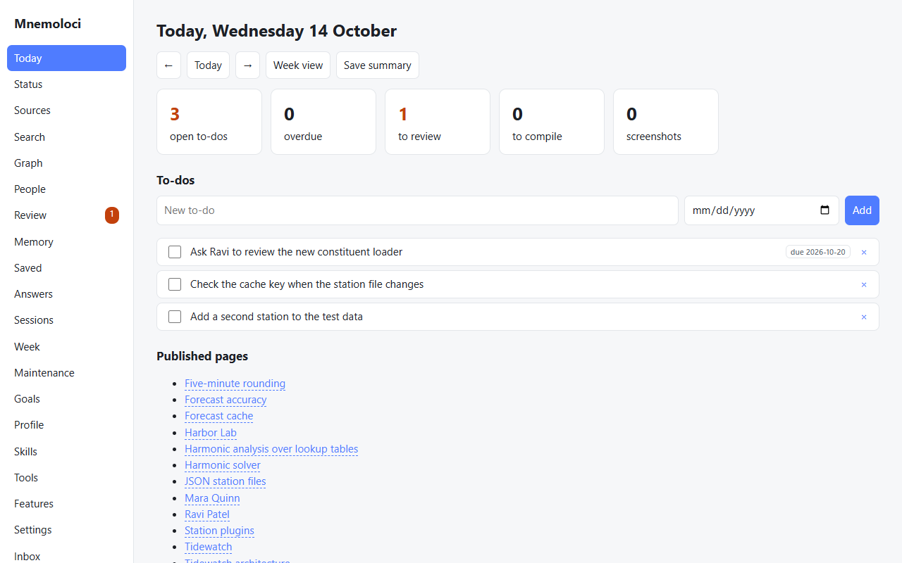
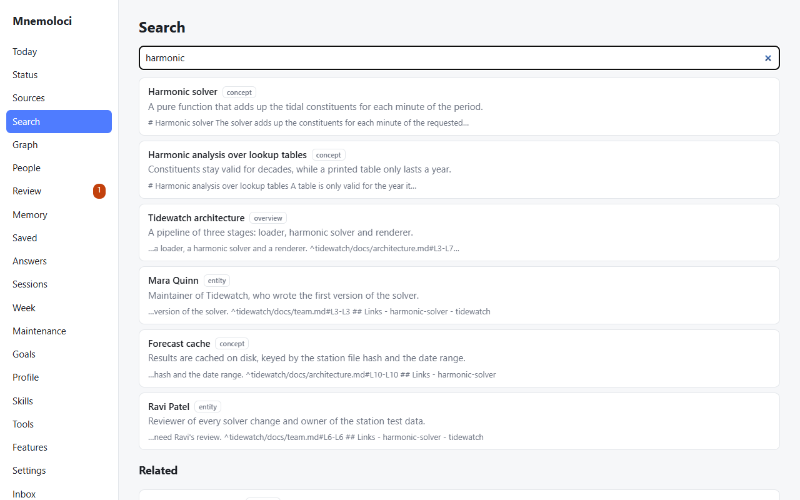
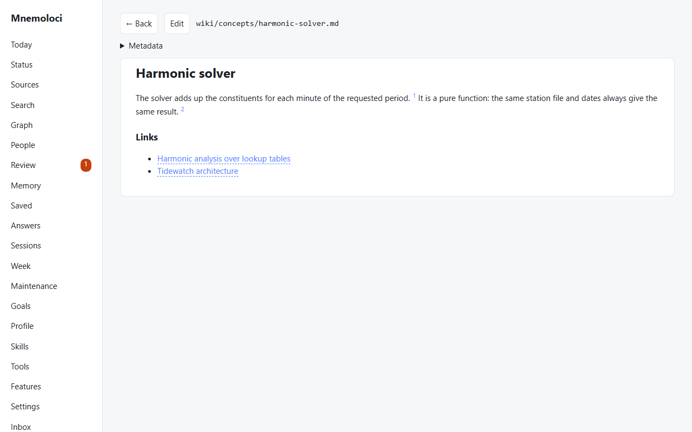
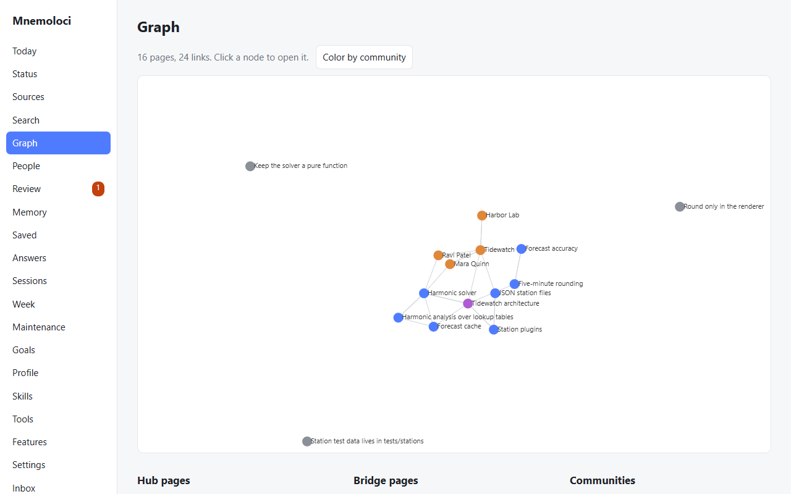
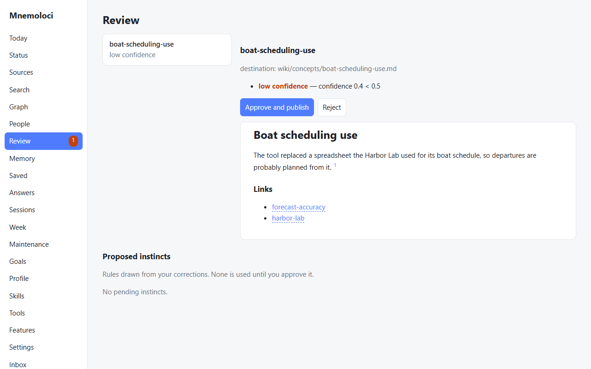

# Mnemoloci

*Read this file in English: [README.md](README.md).*

Second brain personale per Claude Code, per Windows e Linux. Un vault Markdown compatibile con Obsidian è la fonte di verità. Un motore Python deterministico fa hashing, lock, scritture transazionali e indicizzazione; la parte che richiede giudizio la fa la tua sessione di Claude Code.

## Uno sguardo

Questi screenshot mostrano l'app su una vault dimostrativa con contenuti inventati (un piccolo progetto di previsione delle maree).

**Oggi:** cose da fare aperte, cosa aspetta la revisione e le pagine pubblicate oggi.



**Cerca:** risultati con il tipo di pagina, un riepilogo e la riga che corrisponde.



**Una pagina:** ogni frase ha una citazione numerata che rimanda alla riga della fonte.



**Grafo:** come si collegano le pagine, con pagine centrali, ponti e comunità elencati sotto.



**Revisione:** le pagine di cui il motore non è sicuro aspettano la tua decisione prima di essere pubblicate.



## Cosa fa

- Compila i tuoi progetti (codice e file `.md`) in pagine wiki citate, nella lingua della tuo vault, con l'originale conservato.
- Salva pagine web, PDF, video YouTube (trascrizione), file e testo incollato. Le pagine che ne nascono passano sempre dalla revisione.
- Importa le sessioni Claude Code esistenti. Cerca nelle sessioni passate e riprende quella giusta ("dove eravamo rimasti"). A fine sessione scrive da solo un handoff per la sessione successiva.
- Importa le conversazioni di ChatGPT e claude.ai dal loro export, anche quello diviso in più file, e le rende cercabili.
- Cose da fare che passano da una sessione all'altra. Riepilogo del giorno e della settimana. Vista **Oggi** nell'app, che è anche la pagina iniziale.
- Backup git del vault: commit automatico a fine sessione, copia remota facoltativa, versioni precedenti sempre recuperabili.
- Manutenzione solo con la tua approvazione: unisce i doppioni e lascia un rimando, aggiunge i link mancanti, propone pagine di sintesi. Una lezione che confermi di nuovo si rafforza, e le lezioni pertinenti compaiono quando servono. Gli istinti diventano skill. Il curatore delle skill archivia solo su tuo comando.
- Esplorazione:
  - persone ed entità ordinate per importanza attuale;
  - analisi del grafo: pagine centrali, ponti, comunità, collegamenti inattesi;
  - validità nel tempo, con ricerca "com'era alla data X";
  - punteggio di qualità con storico;
  - Canvas e Bases per Obsidian;
  - export `llms.txt`;
  - manutenzione giornaliera pianificata, facoltativa.
- Salva le risposte buone come pagine (`wiki/queries/`), legate alle pagine su cui si basano. Il lint le segnala quando quelle pagine cambiano.
- Protezione dalle istruzioni nascoste (prompt injection) nei contenuti esterni, nella memoria e nel contesto iniettato all'avvio.
- Salva gli screenshot dal telefono: Remote Control o Telegram.
- Tiene profilo, obiettivi, decisioni, lezioni e handoff, iniettati a ogni nuova sessione.
- Trova le skill già presenti sulla macchina, ne crea di nuove con controllo di sicurezza e revisione, e le installa solo su richiesta.
- Impara "istinti" (quando X → fai Y) dalle tue correzioni nelle sessioni passate. Nessuno viene usato finché non lo approvi.
- Ricerca semantica locale e multilingue, gratuita. Export del grafo (HTML offline, GraphML, JSON) e dell'intero vault in JSON.
- Scambio di conoscenza in [Open Knowledge Format v0.2](https://github.com/GoogleCloudPlatform/open-knowledge-format), lo standard di Google Cloud. L'export è conforme. L'import porta i pacchetti di altri strumenti nella coda di revisione e conserva i campi sconosciuti.

## Lingua

Un vault ha una lingua (`language.target` in `.mnemoloci/config.json`, oppure `mnemoloci config language <codice>`). Il motore scrive nella lingua del vault le pagine che genera, i riepiloghi e i suggerimenti: inglese di default, italiano quando la lingua è `it`. `mnemoloci init --language it` crea un vault italiana. L'interfaccia dell'app segue la lingua del browser (inglese o italiano) e si cambia in fondo al menu laterale. Le vault create prima che esistesse questa impostazione sono considerate italiane.

## Dove sta il vault

Mnemoloci lo cerca in quest'ordine: `--vault <cartella>`, la variabile `MNEMOLOCI_VAULT`, il percorso registrato in `~/.mnemoloci/vault.txt`, poi `~/Mnemoloci`. Il primo `mnemoloci init` registra il vault che crea, così hook, server MCP e app usano la stessa. `mnemoloci vault show` dice quale è in uso e perché; `mnemoloci vault set <cartella>` passa a un'altro vault esistente, e nella vista Stato dell'app la sezione **Vault** fa lo stesso (poi riavvia l'app e le sessioni di Claude Code).

## Installazione

Servono Python 3.11 o successivo, git e Claude Code. Su Linux usa `python3` dove i comandi dicono `python`, dentro un ambiente virtuale (vedi la sezione Linux).

1. Installa il motore. Gli extra aggiungono il server MCP (`mcp`), l'app (`app`), la ricerca semantica locale (`semantic`) e la cattura di PDF e YouTube (`ingest`):

```powershell
python -m pip install "mnemoloci[mcp,app,semantic,ingest] @ git+https://github.com/siris9476/mnemoloci"
```

2. Crea il vault e registra il Python che esegue questo comando. Da quel momento hook, server MCP e app usano quello:

```powershell
python -P -m mnemoloci init
```

3. Aggiungi il plugin (skill, hook e server MCP):

```powershell
claude plugin marketplace add https://github.com/siris9476/mnemoloci
claude plugin install mnemoloci@mnemoloci --scope user
```

Poi apri una nuova sessione di Claude Code. Per iniziare:
- "rileggi il progetto X";
- "leggi le mie sessioni";
- "salva questo screenshot";
- "salva questo articolo / PDF / video: <link>";
- "dove eravamo rimasti?" oppure "in quale sessione abbiamo parlato di …?";
- "salva questa risposta";
- "c'è già una skill per …?".

Kimi, Codex e altri agenti possono usare il server MCP in sola lettura con il comando `python -P -m mnemoloci mcp`.

Passi facoltativi:
- Embedding locali per la ricerca semantica: `python -P -m mnemoloci index embed` scarica una volta un modello di circa 220 MB.
- Lavorare da una copia clonata invece dell'installazione da GitHub: `git clone https://github.com/siris9476/mnemoloci`, poi `python -m pip install -e "<percorso della copia>[mcp,app,semantic,ingest]"` e `claude plugin marketplace add <percorso della copia>`.
- L'interfaccia dell'app non fa parte del pacchetto Python, quindi l'app richiede una copia clonata. Compila l'interfaccia una volta (serve Node.js 20 o successivo) con `cd app && npm ci && npm run build`, poi avvia l'app con `python -P -m mnemoloci app`. Senza la compilazione mostra la pagina "Interface not built".

### Scegliere cosa leggere (pagina Fonti)

Nella pagina **Fonti** dell'app (le modifiche si fanno solo dal PC):
- aggiungi un progetto, oppure tutte le sottocartelle di una cartella (per esempio `C:\Users\you\Progetti`), in modalità **solo documenti** (README, note, file di progetto) o **documenti e codice**;
- apri una fonte e navighi le sue cartelle: per ognuna vedi se viene letta, cosa contribuisce e perché una cartella o un file viene saltato:
  - esclusa da te;
  - dipendenze e build;
  - ambiente virtuale Python;
  - `.gitignore`;
  - codice fuori dalla modalità solo documenti;
  - binari;
  - file troppo grandi;
  - possibili segreti;
- con la spunta escludi una cartella, oppure includi una cartella che una regola automatica salterebbe (per esempio una tua cartella `vendor`). Vale la scelta più specifica.

Le stesse impostazioni le usa Claude:
- le legge prima di compilare (`source show NAME`);
- le aggiorna quando glielo chiedi in chat (`source exclude`, `source include`, `source scope`), e la modifica compare nella pagina;
- non esclude mai niente di sua iniziativa.

Le cartelle delle fonti non vengono mai scritte. Da terminale: `source add <cartella> --name <nome> --docs-only`, `source add-many <cartella>`.

### Aggiungere un vault Obsidian

Dall'app (vista Stato, sezione **Fonti**, solo dal PC): incolla il percorso del vault e premi **Aggiungi**. Il vault resta in sola lettura. Per trasformare le note in pagine del wiki, copia la richiesta proposta ("Compila la fonte … di Mnemoloci") e incollala in una sessione di Claude Code. **Controlla** conta le note nuove o cambiate. Da terminale: `python -P -m mnemoloci source add-obsidian <cartella> --name <nome>`.

### Diagnosi e riparazioni

```powershell
python -P -m mnemoloci doctor            # controlla l'installazione (sola lettura)
python -P -m mnemoloci doctor --fix      # ripara ciò che si può riparare da solo, poi ricontrolla
python -P -m mnemoloci doctor --fix --only search-index handoffs
```

Le riparazioni non cancellano nulla. Sono le stesse del pulsante "Ripara" nella sezione "Salute del sistema" dell'app (vista Stato, solo dal PC):
- registrare il Python da usare (`%USERPROFILE%\.mnemoloci\python.txt`);
- ripristinare le scritture interrotte;
- spostare da parte un lock di git bloccato;
- salvare gli handoff in coda;
- ricostruire l'indice;
- solo su richiesta esplicita, calcolare gli embedding.

Hook, MCP e app avviano il motore con il Python registrato (tramite `plugin/bin/launch.py`), quindi un altro `python` messo davanti nel PATH, per esempio un venv, non spegne più la memoria. `init` lo registra la prima volta.

## Linux

Mnemoloci funziona anche su Linux, con lo stesso vault, lo stesso plugin e la stessa app. Serve Python 3.11 o successivo.

Installa come descritto sopra, dentro un ambiente virtuale: crealo con `python3 -m venv ~/.venvs/mnemoloci` e usa `~/.venvs/mnemoloci/bin/python` dove i comandi dicono `python`. `init` registra quel Python e crea il vault in `~/Mnemoloci`, a meno che tu scelga un altro posto.

- Plugin: hook e server MCP passano da `plugin/bin/mnemoloci-run`, uno script `sh` che trova `python3` (o `python`) e poi usa il Python registrato in `~/.mnemoloci/python.txt`. Il virtualenv non va attivato.
- Avvio automatico (`remote autostart --enable`, `projects rc-autostart --enable`):
  - usa un servizio utente di systemd in `~/.config/systemd/user/`;
  - su un server senza login attivo, `loginctl enable-linger` lo tiene acceso;
  - senza systemd, su un desktop, usa una voce in `~/.config/autostart/`.
- Lavoro giornaliero (`schedule enable`): una riga nel crontab dell'utente; senza cron, un timer di systemd.
- Cosa viene toccato: solo file e righe marcati "created by Mnemoloci". Se non c'è né cron né systemd, come in WSL senza systemd, il comando lo dice e indica cosa fare.
- App desktop: l'app Tauri si compila anche su Linux (`cargo build --release` in `app/src-tauri`, servono le librerie di sistema di WebKitGTK), ma su Linux non l'ho ancora compilata né provata. In alternativa, `python3 -P -m mnemoloci app` apre l'interfaccia nel browser.

## App desktop

Ricerca, lettore di pagine, grafo, revisione, obiettivi, profilo, skill e inbox degli screenshot. Poi ci sono **Salvati** (salva un link o incolla un testo, anche dal telefono), **Risposte** (le risposte salvate, con l'avviso quando vanno aggiornate) e **Sessioni** (cerca nelle sessioni passate di Claude Code e rileggile). C'è anche un **editor** delle pagine con anteprima dal vivo: salva con `Ctrl+S` e rifiuta di sovrascrivere una pagina modificata altrove, per esempio in Obsidian, dopo che l'hai aperta.

```powershell
cd app; npm ci; npm run build                           # interfaccia -> mnemoloci\web
python -P -m mnemoloci app                                  # finestra Edge in modalità app (serve la compilazione qui sopra)
cd src-tauri; cargo build --release                       # oppure finestra nativa Tauri:
.\target\release\mnemoloci-desktop.exe                   #   avvia il motore e lo chiude all'uscita
```

L'interfaccia è in italiano o in inglese: si sceglie in fondo al menu laterale (anche nella schermata di abbinamento del telefono), la scelta resta su quel dispositivo e la prima volta vale la lingua del browser. Le pagine del vault restano nella lingua configurata del vault.

L'app parla con il motore su `127.0.0.1`, con un token casuale a ogni avvio. Una pagina web aperta nel browser non può usarla. `MNEMOLOCI_PYTHON` sceglie l'interprete che la finestra Tauri usa per avviare il motore.

## Estensione del browser

Questa funzione è facoltativa e ancora in sviluppo: caricamento, abbinamento e salvataggio sono stati provati in un browser di prova, ma non il pulsante della barra né il menu del tasto destro.

La cartella `extension/` contiene l'estensione per Chrome ed Edge, "Save to Mnemoloci" (in inglese, con la traduzione italiana).
1. Caricala da `edge://extensions` (o `chrome://extensions`): Modalità sviluppatore → Carica estensione non pacchettizzata.
2. Avvia `python -P -m mnemoloci remote serve`.
3. Nelle opzioni dell'estensione inserisci un codice di abbinamento. `python -P -m mnemoloci remote pair` ne stampa uno (vale una volta e scade dopo 10 minuti), e lo mostra anche l'app (Stato).

Dopo puoi salvare la pagina o il testo selezionato con un clic, anche dal menu del tasto destro. Per le pagine dietro login salva il testo che vedi.

## Dal telefono

Due funzioni facoltative. L'accesso dal telefono con Tailscale è ancora in sviluppo.

### Nuovi progetti (Remote Control)

Remote Control è una funzione di Claude Code che permette di guidare una sessione dal telefono. Mnemoloci aggiunge una cosa: "nuovo progetto X" in una sessione così crea la cartella con un `CLAUDE.md` e `git init`, e la registra nel second brain. Prima scegli la cartella progetti, nell'app (Stato → Cartella progetti) o con `python -P -m mnemoloci projects root <cartella>`, e avvia `claude remote-control` lì dentro. Spostare la sessione nella cartella nuova resta manuale: scrivi `/cd <cartella>/X`. La cartella si cambia solo dal PC, e se l'avvio automatico (`projects rc-autostart --enable`) è attivo, viene aggiornato.

### Usare l'app (Tailscale)

Questa parte è facoltativa e ancora in sviluppo. Richiede Tailscale sul PC e sul telefono, con lo stesso account, e i certificati HTTPS attivati per la tua rete Tailscale (tailnet).

Poi l'app si usa anche sull'iPhone. Il server resta su `127.0.0.1`, e solo `tailscale serve` lo rende raggiungibile dai tuoi dispositivi, in HTTPS. Ogni telefono va abbinato con un codice monouso e si revoca dal PC. Il codice dell'accesso remoto è coperto da test automatici che usano un nome Tailscale inventato, ma non è stato provato in tutte le configurazioni.

```powershell
python -P -m mnemoloci remote setup        # istruzioni passo passo e stato attuale
```

Il tuo PC deve essere acceso, e `python -P -m mnemoloci remote serve` deve essere in esecuzione. Per avviarlo con Windows c'è `remote autostart --enable`.

## Disinstallazione

Il vault e i tuoi dati non vengono toccati.

```powershell
claude plugin uninstall mnemoloci@mnemoloci
claude plugin marketplace remove mnemoloci
python -m pip uninstall mnemoloci
```

## Sviluppo

```powershell
python -m venv .venv; .venv\Scripts\python -m pip install -e ".[dev]"
.venv\Scripts\python -m pytest
```

Il plugin (skill, hook, configurazione MCP) sta in `plugin/`, il motore in `mnemoloci/`.

## Crediti

Costruito con Claude (Anthropic) come assistente di programmazione, sotto direzione e revisione umana a ogni passo.

## Licenza

MIT. Vedi [LICENSE](LICENSE); le attribuzioni di terzi sono in [NOTICE](NOTICE).
